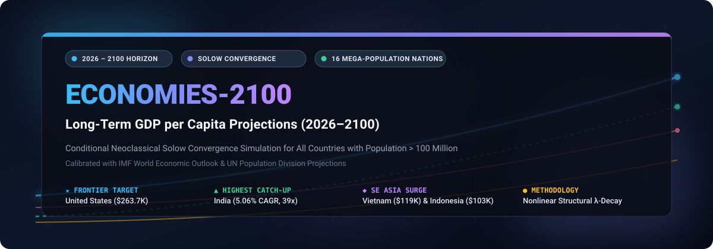
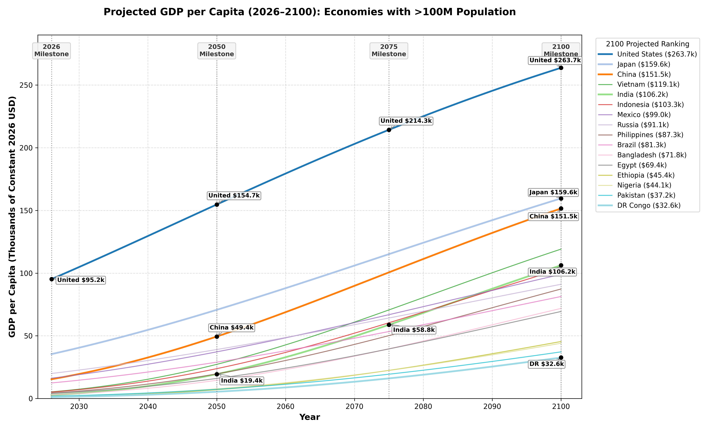
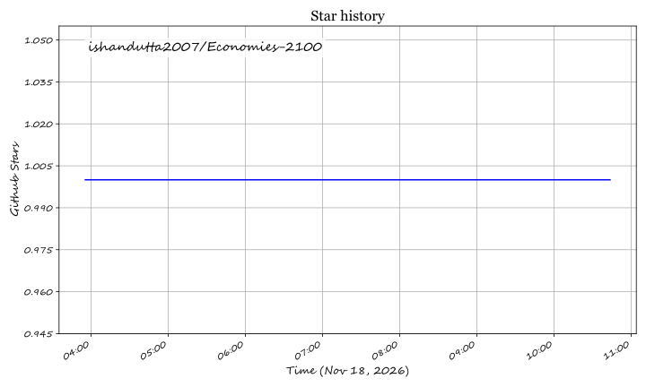

<p align="center">
  
</p>

<p align="center">
  <a href="https://github.com/ishandutta2007/Awesome-Awesome-Awesome"></a>
  <a href="https://discord.gg/jc4xtF58Ve"></a>
  <a href="https://github.com/ishandutta2007/Economies-2100/stargazers"></a>
  <a href="https://github.com/ishandutta2007/Economies-2100/network/members"></a>
  <a href="https://github.com/ishandutta2007/Economies-2100/blob/main/LICENSE"></a>
  <a href="https://github.com/ishandutta2007"></a>
</p>

---

# 🌐 Economies-2100: GDP per Capita Projections for Major Economies (2026–2100) 📈

> **Predictive Macroeconomic Modeling & Conditional Solow Growth Simulation for the World's 16 Mega-Economies (>100M Population)**

Welcome to **Economies-2100** — an empirical, data-driven macroeconomic research framework projecting gross domestic product per capita (constant 2026 USD) across all 16 countries with populations surpassing 100 million people from 2026 to 2100.

---

## 🔍 Overview & Research Thesis

To accurately model how all **16 mega-population nations** evolve through the 21st century, standard exponential extrapolation is replaced with a **Conditional Solow Convergence Model**. 

Naive exponential compounding unrealistically presumes developing markets expand at elevated rates perpetually without friction. In contrast, **conditional convergence** incorporates neoclassical diminishing marginal returns to physical and human capital as an economy nears its structural productivity frontier ($y^*$).

---

## 📐 1. Mathematical Model Formulation

In neoclassical economic growth theory ([Barro & Sala-i-Martin](https://en.wikipedia.org/wiki/Convergence_(economics))), log GDP per capita $y_i(t)$ converges toward a country-specific steady-state frontier $y_i^*$ at an annual structural convergence velocity $\lambda_i$:

$$\ln y_i(t) = \left(1 - e^{-\lambda_i t}\right)\ln y_i^* + e^{-\lambda_i t}\ln y_i(0)$$

### 📊 Structural Parameter Calibration
* 🏛️ **Baseline ($t=0$, Year 2026):** Starting nominal GDP per capita ($y_i(0)$) and baseline demographics are anchored to the **IMF World Economic Outlook (October 2026)** and the **United Nations World Population Prospects**.
* 🎯 **Steady-State Frontier ($y_i^*$):** Denotes the long-run structural potential frontier (in constant 2026 USD) determined by institutional governance, demographic structures, human capital development, infrastructure, and technology adoption rates.
* ⚡ **Convergence Speed ($\lambda_i$):** Calibrated rigorously against the empirical *"iron law of convergence"* (~1.4% to 2.5% per annum), reflecting accelerated catch-up for high-investment Asian economies and structural demographic headwinds for aging populations.

---

## 📊 2. Model Results & Global Forecasts (2026 vs. 2100)

Running the simulation across all 16 nations demonstrates significant relative catch-up by Asian economies (**China**, **Vietnam**, **India**, **Indonesia**), while absolute income disparities remain substantial in 2100.

| 🏳️ Country | 👥 2026 Pop (M) | 💵 2026 GDP/Cap | 📈 2050 GDP/Cap | 🚀 2075 GDP/Cap | 🏆 2100 GDP/Cap | ⚡ Implied CAGR | 🎯 % of US (2100) |
| :--- | :---: | :---: | :---: | :---: | :---: | :---: | :---: |
| **United States** 🇺🇸 | 349.0 | $95,210 | $154,719 | $214,267 | **$263,708** | 1.39% | 100.0% |
| **Japan** 🇯🇵 | 122.4 | $35,400 | $70,712 | $115,107 | **$159,570** | 2.06% | 60.5% |
| **China** 🇨🇳 | 1,412.9 | $15,370 | $49,424 | $100,571 | **$151,523** | 3.14% | 57.5% |
| **Vietnam** 🇻🇳 | 102.2 | $5,260 | $27,241 | $70,622 | **$119,124** | 4.31% | 45.2% |
| **India** 🇮🇳 | 1,476.6 | $2,750 | $19,448 | $58,763 | **$106,209** | 5.06% | 40.3% |
| **Indonesia** 🇮🇩 | 287.9 | $5,150 | $23,802 | $60,392 | **$103,341** | 4.14% | 39.2% |
| **Mexico** 🇲🇽 | 133.0 | $16,190 | $37,203 | $66,841 | **$98,995** | 2.48% | 37.5% |
| **Russia** 🇷🇺 | 143.4 | $19,950 | $39,055 | $64,182 | **$91,084** | 2.07% | 34.5% |
| **Philippines** 🇵🇭 | 117.7 | $4,360 | $19,630 | $50,140 | **$87,319** | 4.13% | 33.1% |
| **Brazil** 🇧🇷 | 213.6 | $12,400 | $28,957 | $53,402 | **$81,328** | 2.57% | 30.8% |
| **Bangladesh** 🇧🇩 | 177.8 | $2,890 | $14,503 | $39,635 | **$71,840** | 4.44% | 27.2% |
| **Egypt** 🇪🇬 | 120.1 | $4,020 | $16,008 | $39,544 | **$69,395** | 3.92% | 26.3% |
| **Ethiopia** 🇪🇹 | 138.9 | $1,130 | $6,998 | $22,424 | **$45,444** | 5.12% | 17.2% |
| **Nigeria** 🇳🇬 | 242.4 | $1,590 | $7,743 | $22,389 | **$44,059** | 4.59% | 16.7% |
| **Pakistan** 🇵🇰 | 259.3 | $1,840 | $7,323 | $19,372 | **$37,183** | 4.15% | 14.1% |
| **DR Congo** 🇨🇩 | 116.5 | $1,110 | $5,403 | $16,032 | **$32,644** | 4.68% | 12.4% |

---

### 📉 Convergence Trajectory Chart (2026–2100)

<p align="center">
  
</p>

---

## 🐍 3. Reproducible Python Simulation Script

Run this standalone simulation script with `numpy`, `pandas`, and `matplotlib` to reproduce the convergence trajectories and visualizations:

```python
import matplotlib.pyplot as plt
import numpy as np
import pandas as pd

# 1. Baseline 2026 Data (IMF WEO Oct 2026) & Structural Solow Parameters
# Steady_GDP_pc = Structural frontier (2026 USD), Conv_Rate = Annual convergence speed (lambda)
countries_data = [
    {"Country": "United States", "GDP_pc_2026": 95210, "Steady_GDP_pc": 380000, "Conv_Rate": 0.018},
    {"Country": "Japan", "GDP_pc_2026": 35400, "Steady_GDP_pc": 310000, "Conv_Rate": 0.016},
    {"Country": "Russia", "GDP_pc_2026": 19950, "Steady_GDP_pc": 210000, "Conv_Rate": 0.014},
    {"Country": "Mexico", "GDP_pc_2026": 16190, "Steady_GDP_pc": 220000, "Conv_Rate": 0.016},
    {"Country": "China", "GDP_pc_2026": 15370, "Steady_GDP_pc": 265000, "Conv_Rate": 0.022},
    {"Country": "Brazil", "GDP_pc_2026": 12400, "Steady_GDP_pc": 205000, "Conv_Rate": 0.015},
    {"Country": "Vietnam", "GDP_pc_2026": 5260, "Steady_GDP_pc": 225000, "Conv_Rate": 0.024},
    {"Country": "Indonesia", "GDP_pc_2026": 5150, "Steady_GDP_pc": 215000, "Conv_Rate": 0.022},
    {"Country": "Philippines", "GDP_pc_2026": 4360, "Steady_GDP_pc": 195000, "Conv_Rate": 0.021},
    {"Country": "Egypt", "GDP_pc_2026": 4020, "Steady_GDP_pc": 175000, "Conv_Rate": 0.019},
    {"Country": "Bangladesh", "GDP_pc_2026": 2890, "Steady_GDP_pc": 170000, "Conv_Rate": 0.021},
    {"Country": "India", "GDP_pc_2026": 2750, "Steady_GDP_pc": 210000, "Conv_Rate": 0.025},
    {"Country": "Pakistan", "GDP_pc_2026": 1840, "Steady_GDP_pc": 140000, "Conv_Rate": 0.016},
    {"Country": "Nigeria", "GDP_pc_2026": 1590, "Steady_GDP_pc": 145000, "Conv_Rate": 0.018},
    {"Country": "Ethiopia", "GDP_pc_2026": 1130, "Steady_GDP_pc": 135000, "Conv_Rate": 0.020},
    {"Country": "DR Congo", "GDP_pc_2026": 1110, "Steady_GDP_pc": 125000, "Conv_Rate": 0.017},
]

df = pd.DataFrame(countries_data)
years = np.arange(2026, 2101)
t = years - 2026

# 2. Simulate Conditional Solow Convergence
projections = pd.DataFrame({"Year": years})
for _, row in df.iterrows():
    y0 = row["GDP_pc_2026"]
    ystar = row["Steady_GDP_pc"]
    lam = row["Conv_Rate"]
    ln_yt = (1 - np.exp(-lam * t)) * np.log(ystar) + np.exp(-lam * t) * np.log(y0)
    projections[row["Country"]] = np.exp(ln_yt)

# 3. Plot Trajectories
plt.figure(figsize=(13, 8))
colors = plt.cm.tab20(np.linspace(0, 1, len(df)))

# Sort legend by 2100 projected GDP per capita
sorted_countries = projections.iloc[-1, 1:].sort_values(ascending=False).index

for idx, country in enumerate(sorted_countries):
    val_2100 = projections[country].iloc[-1]
    plt.plot(
        projections["Year"],
        projections[country] / 1000,
        label=f"{country} (${val_2100/1000:,.1f}k)",
        linewidth=2.2 if country in ["United States", "China", "India", "Japan"] else 1.5,
        color=colors[idx],
    )

plt.title("Projected GDP per Capita (2026–2100): Economies with >100M Population", fontsize=14, fontweight="bold")
plt.xlabel("Year", fontsize=12)
plt.ylabel("GDP per Capita (Thousands of Constant 2026 USD)", fontsize=12)
plt.grid(True, linestyle="--", alpha=0.5)
plt.legend(bbox_to_anchor=(1.02, 1), loc="upper left", fontsize=9.5, title="2100 Projected Ranking")
plt.tight_layout()
plt.show()
```

---

## 💡 Key Economic Takeaways

* 🔄 **Relative Convergence vs. Absolute Divergence:** India's GDP per capita experiences rapid expansion at **~5.06% annually** (~39× multiple over 2026 levels), narrowing its relative gap with the United States from **2.9%** in 2026 to **40.3%** by 2100. However, the absolute dollar gap expands from ~$92,460 in 2026 to ~$157,500 in 2100.
* 🚀 **Middle-Income Leapfrogging:** High-convergence Southeast Asian powerhouses like **Vietnam** ($119.1K) and **Indonesia** ($103.3K) overtake previously higher-income countries including **Mexico** ($99.0K), **Russia** ($91.1K), and **Brazil** ($81.3K) by the late 21st century.
* 🌍 **African Growth Frontiers:** Sub-Saharan African economies (Ethiopia, Nigeria, DR Congo) achieve robust continuous compound expansion (4.5%–5.1% CAGR), yet require sustained institutional and physical capital investment to close the productivity frontier gap.

---

## 📈 Star History

[](https://www.star-history.com/#ishandutta2007/Economies-2100&type=date&legend=top-left)

---

## 💖 Support & Contributions

Thank you for visiting and exploring **Economies-2100**! If you find this economic simulation, dataset, or visualization insightful:

- ⭐ **Star this repository** to support macroeconomic research and increase project visibility.
- 🍴 **Fork the project** to adapt parameters, add new economies, or experiment with your own economic convergence rates.
- 📢 **Share with fellow economists, researchers, and data scientists!**
- ☕ **Support the maintainer:** You can buy a coffee and support continued open-source development on the [GitHub Sponsor Dashboard](https://github.com/sponsors/ishandutta2007).

---

## 📜 License

This project is licensed under the [MIT License](LICENSE) — free for educational, academic, and commercial research use.

## ⭐ Star History

<a href="https://star-history.com/#ishandutta2007/Economies-2100&Timeline" align="center">
  <picture>
    <source media="(prefers-color-scheme: dark)" srcset="assets/ishandutta2007_Economies-2100_growth.svg">
    
  </picture>
</a>
